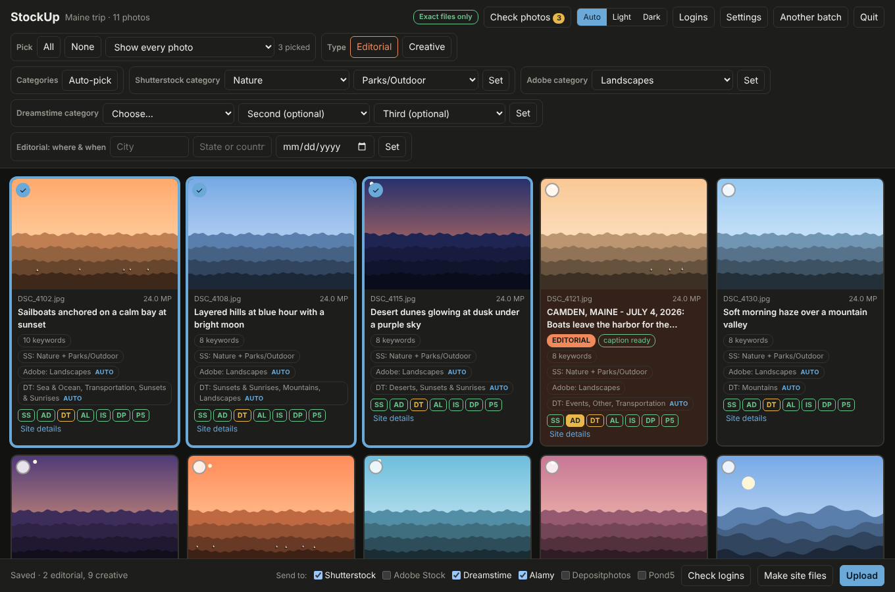
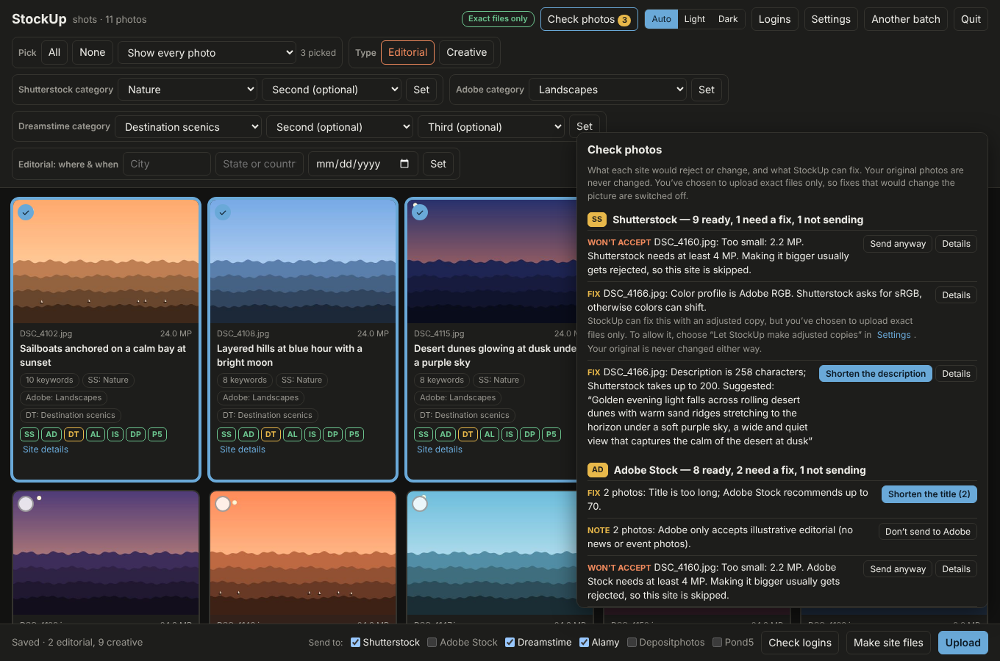
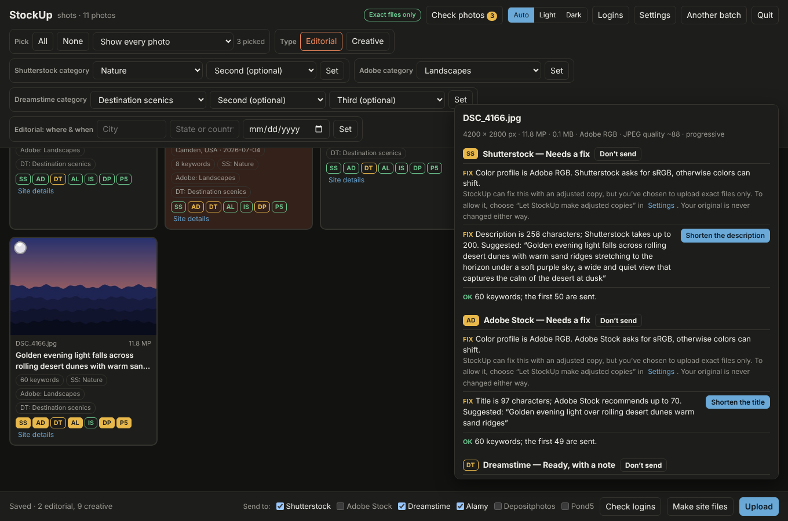
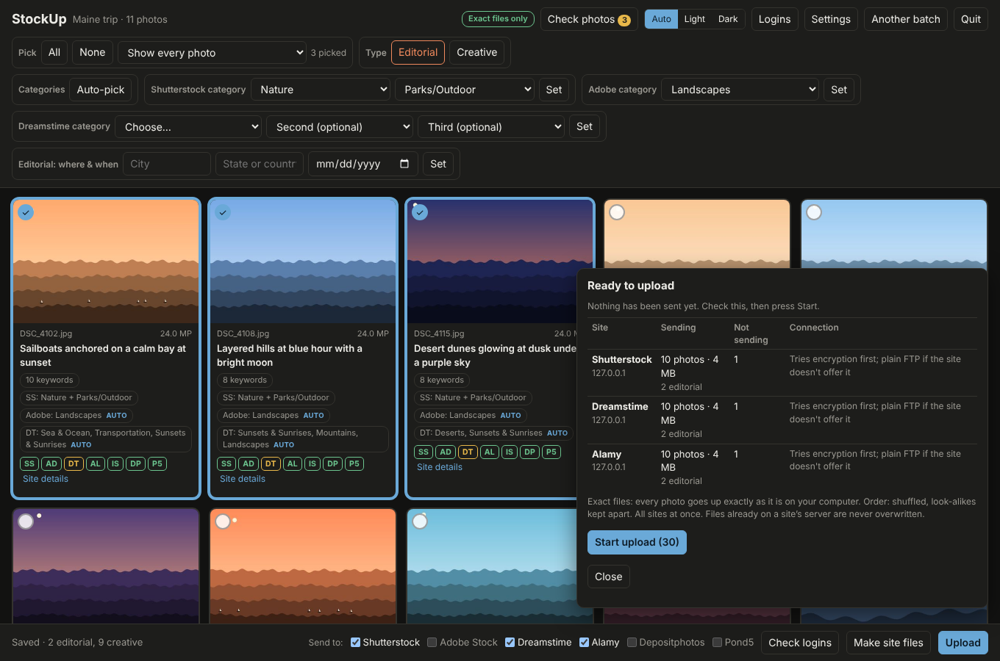
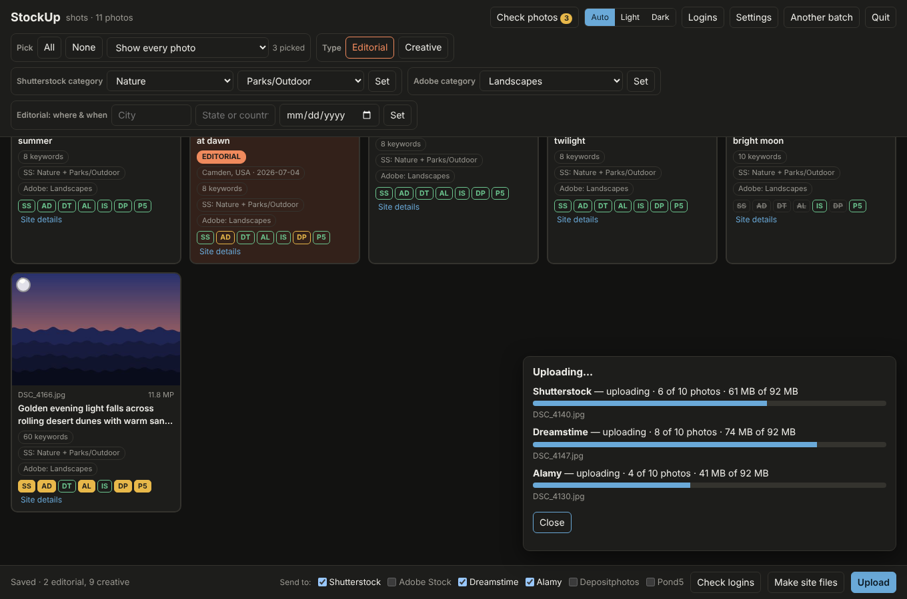
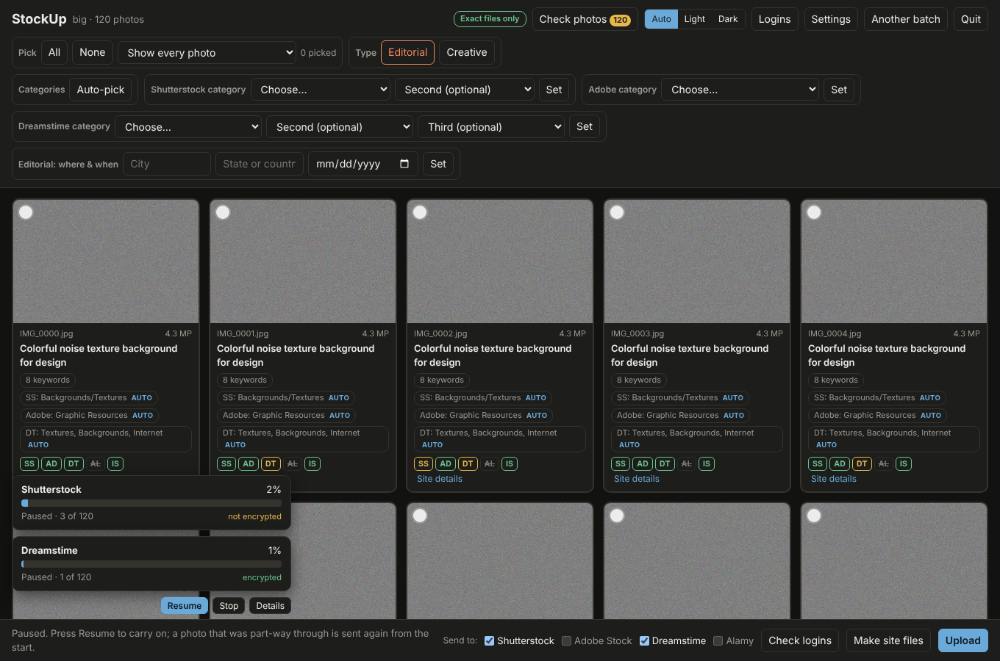
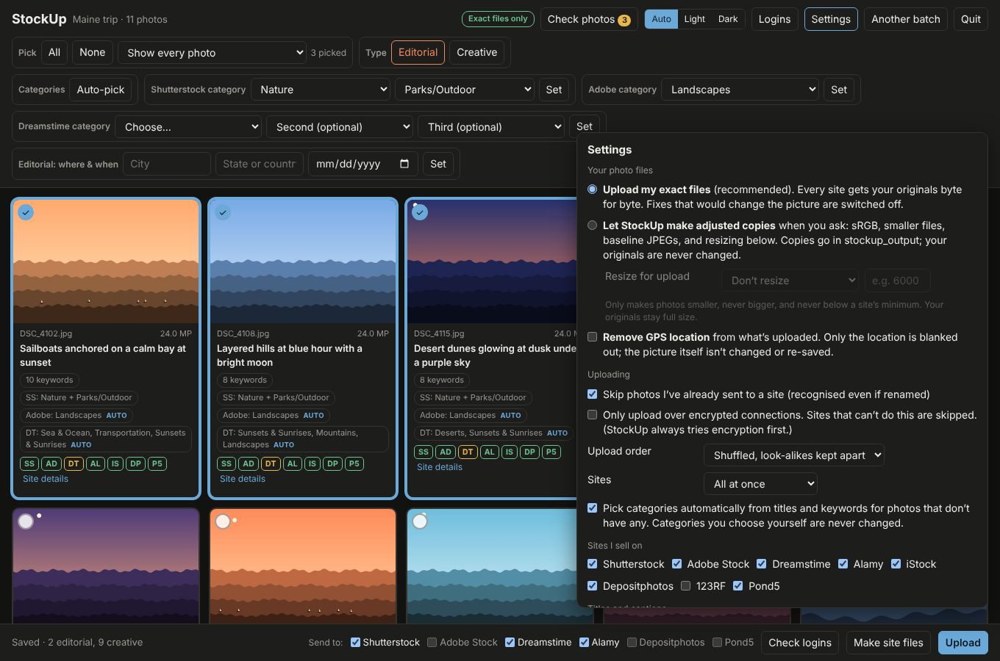
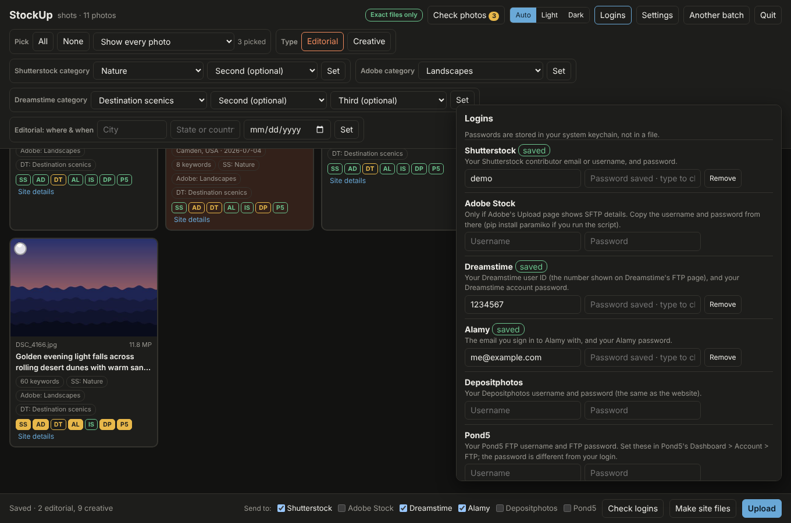
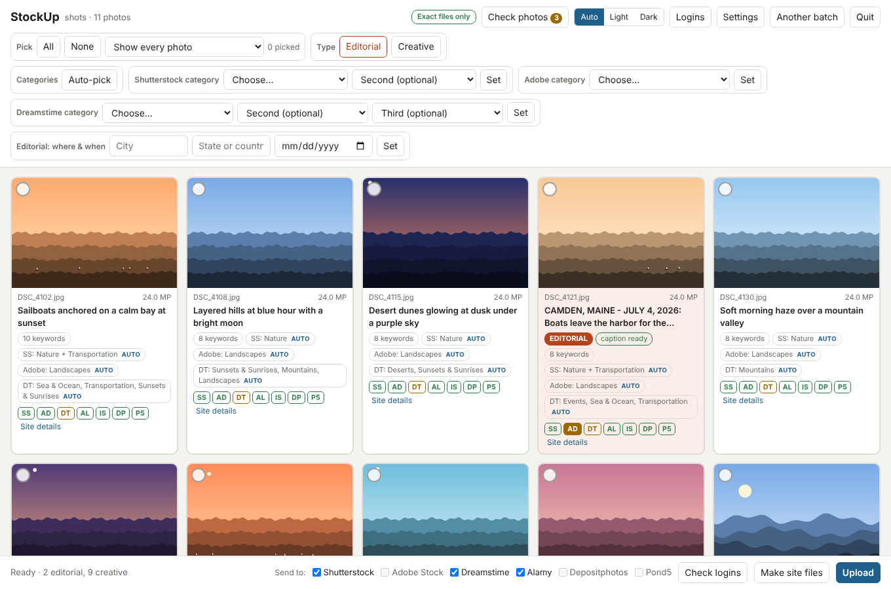

# StockUp

**Send one batch of stock photos to every agency you sell on, without typing anything twice.**

StockUp works with Shutterstock, Adobe Stock, Dreamstime, Alamy, iStock, Depositphotos, 123RF and Pond5.

You keyword and title your photos once, the way you already do. StockUp reads those words from the files and checks each photo against every site's rules. It then makes the files each site asks for and uploads to all of them at once.

**Your photos are safe.** By default, StockUp uploads your exact files, byte for byte, and never writes to your originals. See [Safety](#safety).



## Download

Get the newest version from the **[Releases page](../../releases/latest)**:

| Your computer | Download |
|---|---|
| Mac with Apple silicon (M1 or newer) | `StockUp-Mac.zip` |
| Windows | `StockUp-Windows.zip` |
| Intel Mac, Linux, or you'd rather use Python | `stockup.py` (see [Running the script](#running-the-script)) |

**First time opening it**
- **Mac:** unzip, drag **StockUp** to Applications, then right-click it and choose **Open**. macOS asks this once because the app isn't from the App Store. If it still won't open, go to *System Settings › Privacy & Security* and click **Open Anyway**.
- **Windows:** unzip and double-click **StockUp**. If a blue "Windows protected your PC" box appears, click **More info › Run anyway**.

StockUp asks which folder holds your batch, then opens in your web browser. Nothing is sent anywhere until you click **Upload**.

## What it does for you

- **Checks every photo for every site.** Each photo has a badge per site: green means ready, amber means it needs a fix, and crossed out means it won't be sent. **Check photos** lists everything by site, with a button to fix it.
- **Fixes text problems in a click.** It shortens titles and descriptions that are too long, showing the suggestion first, and gives files a safe name where a site would mangle accents or symbols. Only the spreadsheets or the uploaded file's name change; the photo itself doesn't.
- **Optional adjusted copies,** off by default. If you allow them in Settings, StockUp can make **sRGB** copies, smaller files, standard (baseline) JPEGs for Alamy, and **resize for upload** to a longest side or megapixel size you choose. It never makes photos bigger, and never goes below a site's minimum. Copies are made only for the sites that need them; your originals stay as they are.
- **Skips photos a site won't take,** like ones under its minimum size, so they don't fail review. **Send anyway** overrides this.
- **Picks categories for you** from each photo's title and keywords, for Shutterstock, Adobe and Dreamstime. Picked categories are tagged "auto". **Auto-pick** redoes them for the photos you select, and any category you choose yourself is never changed.
- **Marks editorial in bulk.** Shift-click a range and click **Editorial**. Photos are also marked for you if the caption already starts with a place and date, or if they have a keyword or Lightroom color label you choose.
- **Keeps your captions as written** when they already start with a place and date. For the rest, StockUp adds the place and date in each site's format.
- **Uploads to the sites you tick,** all at once or one site at a time, with a progress bar for each site.
- **Pause, Resume and Stop at any moment,** even partway through a photo. A half-sent photo is removed from the site's server and sent again from the start, so a site never receives a broken file. If the connection drops, StockUp retries; press **Upload** again later and it carries on where it left off.
- **Opens big batches instantly.** You can start tagging straight away while StockUp checks the photos in the background. Reopening a batch is instant because it remembers what it already checked.
- **Shuffles the upload order** and keeps look-alike photos apart, so reviewers don't see a run of near-identical frames. Each site gets its own order.
- **Fills in Dreamstime too:** titles, keywords, up to three categories, and the editorial flag, sent to Dreamstime with one button.
- **Keeps your passwords in your computer's keychain:** Keychain on Mac, Credential Manager on Windows.
- **Light and dark mode,** and an **Update** button when a new version is out.

| Check photos | One photo, site by site |
|---|---|
|  |  |

| Before anything is sent | Uploading, site by site |
|---|---|
|  |  |

| Paused |
|---|
|  |

| Settings | Logins |
|---|---|
|  |  |

<details><summary>Light mode</summary>


</details>

## Safety

- **Exact files by default.** Every site gets your original files, byte for byte. Fixes that would change the picture stay switched off unless you choose **Let StockUp make adjusted copies** in Settings. The badge at the top of the page always shows which mode you're in.
- **Your originals are never written to.** Anything StockUp makes is a separate copy in `stockup_output`. Copies are real copies, never links back to your originals. StockUp also fingerprints every original when it opens a batch and checks them again after making files and after uploading. If another app changed one in the meantime, StockUp tells you.
- **You see everything before it's sent.** **Upload** first shows, for each site: how many photos, which are editorial or copies, what's being left out, and how it will connect. Nothing leaves your computer until you press **Start upload**.
- **Never half a photo.** Pause and Stop work mid-photo, and StockUp removes the part-sent file from the site. If a connection drops partway, StockUp replaces its own half-sent copy when it retries. If a photo has already been fully sent and StockUp is only waiting for the site to confirm it, it finishes that photo first rather than throwing it away; the progress card says so.
- **Nothing on a site's server is overwritten.** If a file with the same name is already waiting there, StockUp leaves it alone.
- **No double uploads.** StockUp remembers what it has sent to each site, across all your batches, and recognises a photo even if it's renamed. A photo already sent is skipped, and one that only *looks* the same is flagged for you to check.
- **Encrypted when possible.** StockUp always tries an encrypted connection first. It only uses plain FTP for a site that doesn't offer encryption, and you can turn that off in Settings. Each site's progress bar shows whether its connection is encrypted.
- **Your location stays private if you want.** Photos carrying a GPS location are flagged. **Remove GPS location** blanks it out of what's uploaded, without re-saving or changing the picture.
- **Passwords** go in your computer's keychain; usernames stay in a settings file only you can read.
- **A receipt of every upload:** `upload_receipt.csv` lists each photo, the site, the time, whether the original or a copy was sent, whether the connection was encrypted, and a fingerprint of exactly what was sent.
- **Only StockUp's page can control StockUp.** Its page runs on your own computer and refuses requests from any other website.

## Each batch

1. Open StockUp and choose the batch folder.
2. The first time, open **Settings** and tick the sites you sell on. Then open **Logins** and add each one.
3. Pick photos and click **Editorial** or **Creative**. Check the categories StockUp picked (change any you like), and add the place and date for editorial shots.
4. Open **Check photos** and apply the fixes you want.
5. Click **Make site files**, tick the sites next to **Send to**, and click **Upload**.
6. Finish on each website. **Make site files** shows the next step for every site:

| Site | What's left to do |
|---|---|
| Shutterstock | On the Submit page, click **CSV** and choose `shutterstock.csv`. This sets descriptions, keywords, categories and the editorial flag. |
| Adobe Stock | Under *Uploaded Files › New*, click **Upload CSV**. Tick editorial for the files in `editorial_list.txt`. |
| Depositphotos | Upload `depositphotos.csv`. This sets the editorial flag too. |
| 123RF | Upload `123rf.csv`. Tick editorial for the files in `editorial_list.txt`. |
| Pond5 | *Uploads › Apply CSV › pond5.csv*. Pond5 only documents its video spreadsheet, so check your first batch. |
| Dreamstime | When the photos show up in Dreamstime's *Unfinished* section, click **Send spreadsheet to Dreamstime** in StockUp. It fills in titles, keywords, categories and the editorial flag. |
| Alamy | Alamy reads your titles and keywords from the photos. Tick "Sell for editorial only" for the files in `editorial_list.txt`. |
| iStock | No upload from StockUp. Drag the `creative` folder into a Creative batch and `editorial` into an Editorial batch. |

Everything is saved in a `stockup_output` folder inside your batch folder, with one folder per site. `checks.txt` lists anything still worth a look, and `upload_receipt.csv` lists everything sent.

## What StockUp checks

| | Smallest photo | Biggest file | Color | Keywords | Text limits |
|---|---|---|---|---|---|
| Shutterstock | 4 MP | 50 MB | sRGB | 7–50 | Description up to 200 characters, at least 5 words |
| Adobe Stock | 4 MP (100 MP max) | 45 MB | sRGB | 5–49 | Title up to 70 characters, file name up to 30 |
| Dreamstime | 3 MP | 1 GB | RGB | | Best-quality JPEG (flags photos saved below about 90%) |
| Alamy | 17 MB when opened (about 6 MP) | | | | Standard (baseline) JPEG |
| iStock | | 50 MB | | | |
| Depositphotos | 3.8 MP | 50 MB | | 8–50 | Description up to 250 characters |
| 123RF | 6 MP | 30 MB | | 7+ | Description up to 180 characters, 4 GB per FTP batch |
| Pond5 | 2 MP, 1200 px each side (170 MP max) | | sRGB or Adobe RGB | 5–50 | Title up to 80 characters |

These come from each site's contributor help pages. Sites change their rules, so check the help pages if a photo is rejected for a reason StockUp didn't flag.

## Good to know

- **Adobe Stock uploads** only work if Adobe has given your account SFTP login details (shown on its Upload page). Otherwise, drag the files into Adobe's website. The spreadsheet still saves the typing.
- **Adobe and editorial:** Adobe only accepts *illustrative* editorial. StockUp flags editorial photos for Adobe so you can choose to skip them.
- **Dreamstime's username** is the user ID number shown on its FTP page, not your email.
- **Pond5** uses a separate FTP password, which you set in Pond5's *Dashboard › Account › FTP*.
- **Photos must be JPEGs** with titles and keywords saved in them, the way Lightroom, Bridge, Photo Mechanic and most keywording tools save them.

## Tested on every release

StockUp has an automated test suite in `tests/` that checks its safety features and the files it makes for each site. It runs on Mac, Windows and Linux after every change, and a new version is only published if every test passes. To run it yourself:

```
pip install pillow pytest
python -m pytest
```

## Running the script

If you'd rather not use the app, install [Python](https://www.python.org/downloads/), download `stockup.py`, and run it:

```
pip install pillow keyring paramiko      optional extras: fixes, keychain, Adobe SFTP
python stockup.py                        then choose your batch folder
```

On a Mac, use `python3`, and once after installing Python, run *Applications › Python 3 › Install Certificates*. The script updates itself from the **Update now** button.

Other commands:

```
python stockup.py build  "My Batch"                             make the site files only
python stockup.py upload "My Batch" --sites shutterstock,alamy   upload without the page
python stockup.py test                                          check your logins
python stockup.py update                                        install the newest version
```
